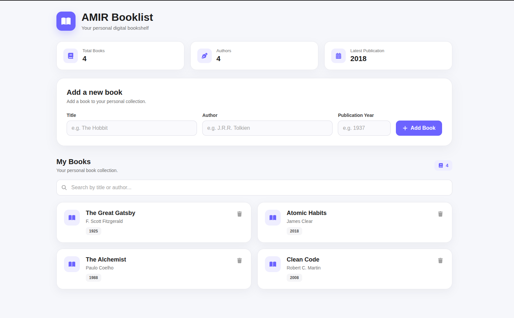

# 📚 AMIR Booklist

A clean and responsive React application for managing a personal book collection.

Users can add books, search through their collection, view basic statistics, and remove books. The application stores book data in the browser using LocalStorage, so the collection remains available after refreshing the page.

## ✨ Features

- 📖 Add books with title, author, and publication year
- 🔍 Search books by title or author
- 🗑️ Delete books with confirmation
- 📊 View collection statistics
- 💾 Persistent data storage with LocalStorage
- ✅ Form validation
- 📱 Responsive design for desktop and mobile
- 🎨 Clean and modern user interface
- ⚡ Fast development and production build with Vite

## 📸 Screenshot



## 🌐 Live Demo

[Open the live application](https://amirkhezry.github.io/booklist/)

## 🛠️ Built With

- React
- JavaScript
- Vite
- CSS
- React Icons
- LocalStorage

## 📂 Project Structure

```text
src/
├── components/
│   ├── Header/
│   ├── AddBook/
│   ├── BookList/
│   ├── BookCard/
│   └── Stats/
├── App.jsx
├── App.css
└── main.jsx
